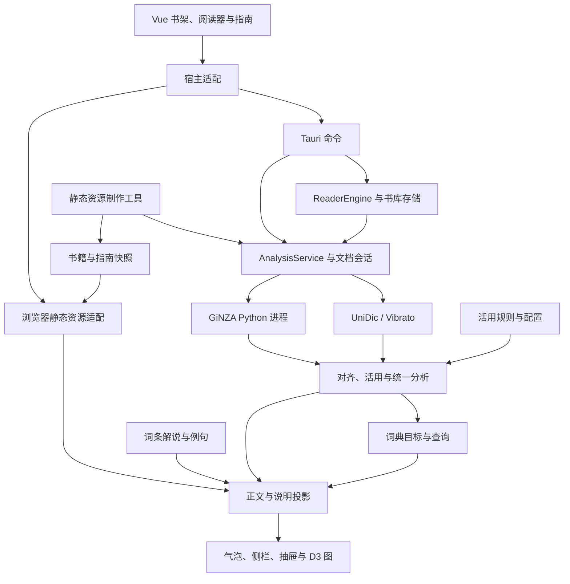

# 总体架构

更新日期：2026-11-09。本文说明当前实现与核心资产；后续方向见[开发目标](goals.md)，文档交接及整理范围见[总计划](documentation_update_plan.md)。

## 系统组成

ReadUX 由 Vue 应用、宿主适配、本机 Rust 服务、UniDic/Vibrato、GiNZA Python 进程、规则词条资源及静态内容制作工具组成。语言分析生成带身份与范围的结果，词典服务生成查询目标和内容，前端将结果投影为正文交互、解说和关系图。

| 部分 | 职责 | 入口 |
| --- | --- | --- |
| 应用协调 | 书架与阅读页面切换，打开书籍、选择及笔记操作，指南入口与设置 | `src/main.ts`、`src/App.vue` |
| 前端服务适配 | 根据宿主调用 Tauri、开发 NLP bridge 或浏览器静态资源接口 | `src/services/reader.ts`、`nlp.ts`、`staticLibrary.ts`、`staticAnalysis.ts` |
| 桌面宿主 | 命令注册、文件与资源路径、书库和阅读状态、平台窗口能力 | `src-tauri/src/lib.rs`、`reader_engine.rs` |
| 应用核心 | 请求分派、文档单元与会话、分析调度、provider 管理、词典和缓存 | `crates/readux-core/src/` |
| 语言分析 | 正文准备、词法、对齐、来源结构、活用链及查询所需对象 | `crates/readux-nlp/src/` |
| Python provider | 加载及复用 GiNZA，将 token、UD 关系和结构转换为来源产物 | `scripts/nlp_provider.py`、`nlp_adapters.py`、`nlp_resources.py` |
| 内容制作 | 调用本机服务，生成指南快照和发布书籍的静态资源 | `scripts/generate_grammar_guide_analysis.py`、`generate_static_library.py`、`build_edgeone.py` |

## 本机分析与文档会话

桌面阅读通过 `ReaderEngine` 访问书库和阅读状态，通过 `AnalysisService` 管理文档分析。文档计划将准备后的正文组织为分析单元，记录原文映射、范围和语域；会话根据打开位置和请求范围安排单元处理。

一个完整单元的当前处理路径为：

1. 读取可用的完整分析缓存。
2. 缓存未命中时，调用 UniDic/Vibrato 和 GiNZA，取得词法与结构来源。
3. `unify_with_sources` 校验来源，在共同正文坐标上完成成员映射和结构整合，执行活用分析并生成构词、词典候选及其他基础对象。
4. 词典目标构建根据词形、成员、活用及词典证据生成查询对象。
5. 保存完整单元的分析和查询产物，通过会话更新协议交给前端。

`document_session.rs` 负责范围请求、继续、取消、重试、版本及任务代次，`analysis_progress.rs` 和前端会话组件组织进度。前端使用单元范围和增量产物更新正文及查询目标。

CLI 的 `inspect` 和 `repl` 调用基础 `Analyze` 请求，GiNZA 追加通过 `enrich` 请求执行。整书会话使用上述完整单元处理路径。开发工具和文档说明需要区分各入口执行的阶段。

主要对象包括 `UnifiedDocument`、`DocumentPlan`、单元更新及查询目标。正文范围、来源身份、分析产物和界面查询各有相应引用；当前结果协议的字段以 Rust 类型及 `src/types/nlp.ts` 为准。

## 活用状态机与规则

活用分析读取 UniDic 的词性、活用型、活用形和词元字段，确定核心、功能身份及初始状态。状态机按登记条件选择执行器，处理局部接续、词性转换、补助递归、插入、判断和文言等情况。

`MorphologyChain` 保存核心、成员、词形、最终状态及父子关系；operator 保存一次规则作用的前后状态、命中范围、词条概念和连接信息；occurrence 保存可解释的实际出现及范围。接续记录还包含具体规则路径、前项范围和连接器身份，供解说和图示使用。

GiNZA 信息通过 `linguistic_context.rs` 进入局部判断。该接口提供正式词元、词性、活用和结构范围，以及有向依存检查。部分接续会结合 `aux`、`cop` 等关系，插入补助等构式进一步核对连接器、插入成员与谓语之间的依存。具体条件在状态机及配置中定义。

规则维护入口为 `configs/unidic-nlp/morphology/source/`，包含 operator 定义、执行元数据、特征与接续规则、文言范式、路径、副词资格和展示配置。`scripts/build_morphology_config.py` 生成 `configs/unidic-nlp/morphology.json`，Rust 和前端消费同一配置。源目录 [README](../configs/unidic-nlp/morphology/source/README.md) 提供就近索引。

## 词条解说与 grammar 资源

活用规则通过 concept 关联解说，前端根据命中的 operator 生成当前词条和接续说明。资源分工如下：

| 资源 | 当前用途 |
| --- | --- |
| `configs/unidic-nlp/morphology/source/operators/` | 规则名称、概念引用、原型、变体、输入输出状态及接续归属 |
| `configs/grammar/particles.json` | 阅读器与指南使用的内置助词解说 |
| `configs/grammar/auxiliaries.json` | 内置助动词解说及例句，活用说明也读取其中部分内容 |
| `configs/grammar/migrations/te_construction_ids.json` | 历史 ID 映射，前端部分补助词处理仍有引用 |
| `crates/readux-core/resources/grammar/source/` | 概念、用法、实现形式、规则及解说的源内容 |
| `crates/readux-core/resources/grammar/compiled/` | 编译后的目录、解说和索引；活用前端直接读取其中的解说文件 |

`morphologyBubble.ts` 按 operator 的 `concept_id` 读取 `grammar_explanations.json`，并结合内置助动词资源选择摘要和例句。`particleEntries.ts` 根据语素身份生成助词、助动词查询，阅读器和指南均调用这一接口。

原 grammar 整体分析流程及语法库界面设计已过时。普通分析链路未调用 `language_analysis::apply`；当前 `refresh_language` 保存已有结果。通用规则预览仍有请求入口，grammar catalog 的搜索及概念查询也仍注册于 Tauri。上述目录中的现用词条解说继续参与活用与阅读显示，各部分以实际调用说明用途。

## 查询、说明视图与 D3 图

Rust 词典模块负责词典源包和索引、候选形式、整体与内部查询目标、表记矩阵以及词条内容。前端 `lookupPresentation.ts` 将查询目标与活用产物关联，生成正文命中、活用详情和显示范围。

说明界面共用查询对象和内容，按布局选择气泡、侧栏或抽屉。`morphologyLayout.ts` 管理激活及布局模式，`useExplanationSheet.ts` 负责抽屉高度和拖动，其他 explanation 模块处理命中、测量、定位及交互。宽屏固定布局使用侧栏，窄屏固定布局使用抽屉。

图示的数据、布局和绘制有明确分工：`morphologyBubble.ts` 生成句中组成及规则分支，`morphologyGraph.ts` 使用 D3 计算布局，`ReaderMorphologyGraph.vue` 绘制节点及连线并处理过渡，`ReaderConnectionTree.vue` 组织两部分图示及折叠状态。正文高亮引用分析投影中的对象及范围，与词条、句中节点和接续路径对应。

这些组件同时服务阅读器与语法指南，是后续分析模块解释关系和展示规则的现有基础。

## 静态 Web 与语法指南

静态书籍由本机服务生成。公开书目位于 `public/library/catalog.json`，每本书的版本目录包含 manifest、正文、分析计划、分析分片、查询索引、词典与语法内容，以及封面和插图。

浏览器的 `staticLibrary.ts` 提供书库及保存操作，`staticAnalysis.ts` 提供与阅读组件协作的静态会话和查询接口。页面按照阅读范围加载分片，查询内容按索引获取；内存中保留有限资源窗口。浏览器持久状态使用 localStorage。

指南内容位于 `src/grammar-guide/`。每课分别保存讲解与例句内容、分析快照和词典快照；例句复用正文及说明组件。生产构建通过 `grammar_guide_assets.mjs` 生成 gzip 资源，由浏览器解压读取。指南课节注册和直达参数由 `GrammarGuidePanel.vue` 管理。

## 数据与资源所有权

| 数据 | 当前保存位置或管理入口 |
| --- | --- |
| 桌面书库与原书资源 | 系统文档目录的 `ReadUX Library/`，索引为 `library.sqlite`，书籍文件位于 `books/<id>/` |
| 桌面阅读状态、摘录和笔记 | Tauri 应用数据目录的 `reader-state.sqlite` |
| provider 配置、日志与分析缓存 | `ResourcePaths` 指定的数据目录；主要文件为 `providers.local.json`、`provider-logs/` 和 `analysis-cache/*.msgpack` |
| 词典源包与查询索引 | `.kdict` 源包和 `dicts/` 查询数据库，具体位置由开发及发行资源定位确定 |
| 静态阅读及指南编辑状态 | 浏览器 localStorage，指南快照与发布内容作为资源读取 |
| 规则、词条和静态内容源 | 仓库中的配置及内容文件，由对应制作脚本生成运行产物 |

开发 CLI 的默认数据目录为仓库 `data/`；桌面阅读状态与书库由 Tauri 定位。`READUX_DATA_DIR` 的作用要结合宿主说明，详见[开发说明](development.md)。

## 后续方向及研究

后续语言分析包括词组范围及修饰并列、格关系及句中成分、登记语法模式三个模块，并配套匹配、用法、解说及 UI。文档目录规划在 `docs/language_analysis/`；具体处理流程、对象及接口留待后续讨论。

收藏管理和统计、Anki 导出、阅读器替换与 LLM 调用的目标见[开发目标](goals.md)。当前 Anki 相关旧文件及 LLM 抽象尚需核实接入方式，阅读器尚使用自研正文呈现。

GiNZA GPU 优化、云端推理等研究材料保存在 [research](research/)。[GPU 并行设计](research/ginza_gpu_parallel_design.md)、[云端推理方案](research/cloud_saas_roadmap.md)和[部署实验](research/cloud_gpu_first_experiment.md)保留其研究环境与状态，本轮整理通过总体文档提供入口。
