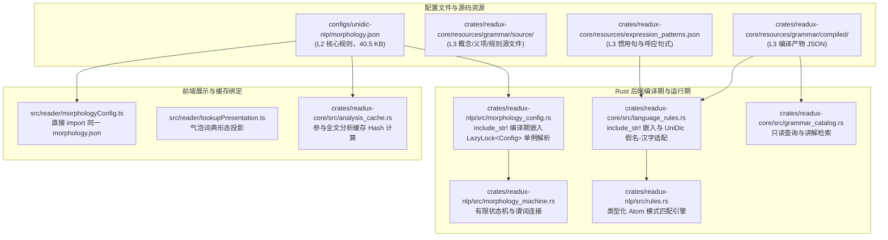
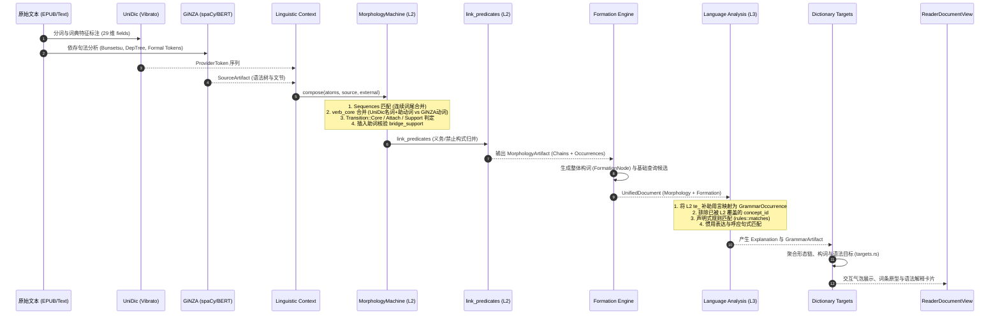
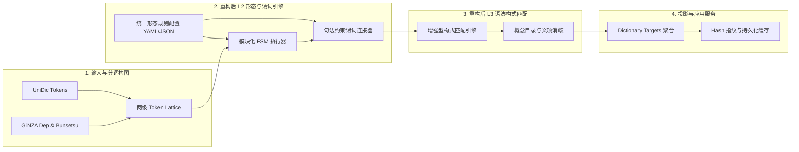

# 语法与活用链分析现状及重构架构分析

## 1. 概述与设计定位

ReadUX 的语法与形态分析体系采用分层流水线（Layered Pipeline）架构，旨在将分词（UniDic / Vibrato）、句法依存（GiNZA / spaCy）、形态曲折、补助用言、语法构式与成语表达有机结合，最终输出供词典查询、语法讲解浮窗展示和学习画像追踪使用的精确结构单元。

系统在设计上将语法和活用划分为两个核心层级：
- **L2 形态活用链（Morphology Chains）**：处理词汇核心（动词、形容词、形状词、サ变名词）与其依附的助动词、接续助词、曲折变化、缩约形、补助用言（如「〜ている」「〜ておく」）、连用复合动词（如「〜始める」「〜すぎる」）以及相邻谓词构式（如义务「〜なければならない」、禁止「〜てはならない」）。该层以有限状态机（FSM）驱动，融合多源 NLP 证据。
- **L3 语法构式与表达库（Grammar & Expression Catalog）**：消费 L2 产出的形态链、状态与词汇核心，匹配高层语法构式、句型、惯用句与跨文节呼应表达（如「決して〜ない」「まるで〜ようだ」）。该层以声明式规则库与概念目录（Concept / Sense）驱动。

---

## 2. 识别模式的范围与清单统计

系统当前涵盖的模式可分为 **L2 活用链层** 与 **L3 语法表达层** 两个维度，全部具备显式的模式标识符与结构定义。

### 2.1 L2 活用链系统（共 95 个 Operators、42 条 Features、14 条 Sequences、12 条 Predicate Links、29 条 Connections）

所有的 L2 模式在 `configs/unidic-nlp/morphology.json` 中统一声明。

#### 2.1.1 算子（Operators，共 95 种）
算子定义了单步状态转移或多步构式的形态/语法操作，映射到特定的语义概念路由（Concept ID）与规范原型（Prototype）：

| 范畴 | 数量 | 典型 Operator 标识符 | 覆盖形态与原型 |
| :--- | :---: | :--- | :--- |
| **极性 (Polarity)** | 1 | `negative` | ない、ぬ、ず、ん |
| **语态 (Voice)** | 2 | `passive_potential`, `causative` | れる／られる（被动/可能/尊敬/自发）、せる／させる／しめる（使役） |
| **时态 (Tense)** | 1 | `past` | た、だ |
| **敬体 (Politeness)** | 2 | `politeness_masu`, `politeness_desu` | ます、です |
| **情态/推量 (Modality/Mood)** | 7 | `deshou_modality`, `sou_modality`, `you_modality`, `mitai_modality`, `rashii_modality`, `volitional`, `negative_volitional` | でしょう、そうだ（样态/传闻）、ようだ、みたいだ、らしい、う／よう（意志）、まい |
| **愿望与评价 (Desire & Evaluation)** | 4 | `desire`, `desire_outward`, `ease`, `difficulty` | たい、たがる、やすい、にくい |
| **断定与系词 (Copula)** | 2 | `copula`, `copula_aru` | だ、である |
| **句法修饰与形式 (Forms)** | 5 | `te_form`, `de_form`, `adverbial_ni`, `attributive_na`, `nominalization` | て、で、连用修饰「に」、连体修饰「な」、名词化「さ」 |
| **当为、命令与禁止** | 3 | `obligation`, `imperative`, `prohibitive` | べきだ、命令形、终助词禁止「な」 |
| **接续与条件助词** | 12 | `te_connection`, `ba_connection`, `tara_condition`, `to_condition`, `nara_condition`, `nagara_connection`, `concessive_connection`, `kedo_connection`, `keredomo_connection`, `ga_connection`, `noni_connection`, `node_connection`, `kara_connection` | て/で、ば、たら、と、なら、ながら、ど、けど、けれども、が、のに、ので、から |
| **否定接续与否定条件** | 6 | `negative_de`, `negative_zuni`, `negative_ba`, `negative_tewa`, `negative_to`, `tewa_condition` | ないで、ずに、なければ（なきゃ/なけりゃ）、なくては（なくちゃ）、ないと、ては（ちゃ/じゃ） |
| **补助用言 (`te` 组)** | 19 | `te_iru`, `te_aru`, `te_shimau`, `te_oku`, `te_iku`, `te_yuku`, `te_kuru`, `te_miru`, `te_kudasaru`, `te_morau`, `te_ageru`, `te_kureru`, `te_yaru`, `te_hoshii`, `te_goran`, `te_miseru`, `te_tamaranai`, `te_naranai`, `te_yamanai` | ている（居る）、てある（有る）、てしまう（仕舞う）、ておく（置く）、ていく（行く）、てゆく、てくる（来る）、てみる（見る）、てくださる（下さる）、てもらう（貰う）、てあげる（上げる）、てくれる（呉れる）、てやる（遣る）、てほしい（欲しい）、てごらん（御覧）、てみせる（見せる）、てたまらない、てならない、てやまない |
| **口语缩约补助用言 (`contracted` 组)** | 3 | `contracted_te_iru`, `contracted_te_shimau`, `contracted_te_oku` | てる／でる（规范化为 ている）、ちゃう／じゃう（规范化为 てしまう）、とく／どく（规范化为 ておく） |
| **连用复合动词 (`continuative` 组)** | 13 | `excessive`, `inceptive`, `continuative_aspect`, `terminative`, `iterative_aspect`, `inchoative`, `corrective`, `incomplete`, `completion`, `reluctance`, `failure`, `missed_opportunity` | すぎる、始める、続ける、終わる、まくる、出す、直す、掛ける、切る、兼ねる、損なう、そびれる |
| **列举与举例 (`enumerative` 组)** | 3 | `enumerative`, `tari_suru` | たり、たりする |
| **义务构式 (Necessity Links)** | 9 | `necessity_negative_ba_naru`, `necessity_negative_ba_ikeru`, `necessity_negative_ba_dame`, `necessity_negative_tewa_naru`, `necessity_negative_tewa_ikeru`, `necessity_negative_tewa_dame`, `necessity_negative_to_naru`, `necessity_negative_to_ikeru`, `necessity_negative_to_dame` | なければ／なくては／ないと ＋ ならない／いけない／だめ |
| **禁止构式 (Prohibition Links)** | 3 | `prohibition_tewa_condition_naru`, `prohibition_tewa_condition_ikeru`, `prohibition_tewa_condition_dame` | ては／ちゃ／じゃ ＋ ならない／いけない／だめ |

#### 2.1.2 单 Token 特征规则（Features，共 42 条，覆盖 28 种语义特征）
从 UniDic 单 token 的 `pos`, `sub`, `ctype`, `cform`, `lemma` 等字段识别算子特征。包含排除规则（`exclude`），如：
- `past`：排斥已然形、假定形与融合形。
- `politeness_desu`：排斥意志推量形，以将「でしょう」单独分流给 `deshou_modality`。
- `negative`：覆盖「ない」「ぬ」「ず」「ん」的不同活用与词性形态。

#### 2.1.3 连续语法词尾序列（Sequences，共 14 组）
用于处理多个 UniDic token 黏合而成的复合词尾，优先于单步转移执行：
1. `keredomo_connection`：`けれど` + `も`
2. `noni_connection`：`の`（准体助词） + `に`（格助词）
3. `node_connection`：`の`（准体助词） + `で`（助动词-ダ）
4. `negative_ba`（两组）：助动词-ナイ[假定形] + `ば`；助动词-ナイ[融合形]（如「なきゃ」「なけりゃ」）
5. `negative_tewa`（两组）：助动词-ナイ[连用形] + `て` + `は`；助动词-ナイ[连用形] + `ちゃ`
6. `negative_to`（两组）：助动词-ナイ[终止形] + `と`（含限定句末省略结构 `terminal_only`）
7. `negative_de`：助动词-ナイ[终止形] + `で`
8. `negative_zuni`：`ず` + `に`
9. `tewa_condition`（两组）：`て/で` + `は`；`ちゃ/じゃ`
10. `nara_condition`：助动词-ダ[假定形]「なら」

#### 2.1.4 跨谓词连接构式（Predicate Links，共 12 组）
在前后两个谓词链各自完成活用后，检测前项算子前缀（`prefix`）与后项谓词原型的匹配，建立父子链与构式 Occurrence：
- 前项 3 类：`negative_ba`, `negative_tewa`, `negative_to`（义务前缀）；`tewa_condition`（禁止前缀）。
- 后项 3 类：动词「なる/成る」、动词「いける/行ける」、名词/形状词「だめ/駄目/ダメ」。
- 要求后项必须带有否定算子证据（「だめ」除外）。

#### 2.1.5 跨成分插入支持（Insertion Patterns，共 2 类）
允许副助词与係助词（如「は」「も」「さえ」「こそ」「だけ」「まで」「しか」「すら」「なんて」「など」）插入在连用接续「て/で」与补助用言之间（如「読んではいる」「読んでもいる」）。必须由 GiNZA 依存句法（`mark`, `case`, `advcl`, `aux`）进行结构核验后方可成立。

---

### 2.2 L3 语法表达系统（共 113 个 Concepts、162 个 Senses、125 条 Rules、27 个 Expression Patterns）

#### 2.2.1 编译语法目录（Compiled Grammar Catalog）
存储于 `crates/readux-core/resources/grammar/compiled/grammar_catalog.json`：
- **Grammar Concepts（113 个）**：标准化的语法概念实体，定义概念 ID（如 `grammar.aspect.te_iru`、`grammar.obligation.nakereba_naranai`）、规范标题、JLPT 等级（N5–N1）、语义领域（`semantic_domains`）、功能标签（`function_tags`）及默认讲解引用。
- **Grammar Senses（162 个）**：语法的具体义项，细分具体语境下的语义功能、上下文约束与排除条件。
- **Grammar Rules（125 条）**：声明式多语素模式匹配规则，类型涵盖：
  - `grammar_construction`（语法句型/构式）
  - `functional_morpheme`（功能语素）
  - `morphology_feature`（形态特征标记）

#### 2.2.2 表达模式库（Expression Patterns）
存储于 `crates/readux-core/resources/expression_patterns.json`：
- **连续惯用模式（15 个 patterns）**：多语素紧邻构成的惯用句或短语结构。
- **呼应/跨文节非连续模式（12 个 correlative_patterns）**：定义跨越任意词元或限制文节间隔（`gap_bunsetsu`）的前后呼应句式（如副词呼应否定「決して〜ない」「めったに〜ない」、比况呼应「まるで〜ようだ」）。

#### 2.2.3 辅助模式
- **文节切分辅助模式（6 个）**：`bunsetsu_patterns.json`
- **复合构词辅助模式（3 个）**：`word_formation_patterns.json`

---

## 3. 规则的存储形式与存储位置

规则体系在物理存储、编译机制与前后端共享上采用了分级与统一策略：

### 3.1 L2 规则存储：`configs/unidic-nlp/morphology.json`
- **格式**：纯 JSON，遵循紧凑的条件声明语法。
- **存储位置**：`d:\PROJ\GIT\kotoclip\configs\unidic-nlp\morphology.json`。
- **加载机制**：
  - **Rust 宏嵌入**：`readux-nlp/src/morphology_config.rs` 中通过 `include_str!("../../../configs/unidic-nlp/morphology.json")` 编译进可执行文件，并通过 `LazyLock<Config>` 在首次访问时完成反序列化。
  - **前端原生复用**：`src/reader/morphologyConfig.ts` 使用 Vite/TS 的 JSON 模块导入能力直接引用该文件，确保展示层原型名称、缩约标签与后端状态机算法严格保持单事实来源（Single Source of Truth）。
  - **缓存失效联动**：`crates/readux-core/src/analysis_cache.rs` 将该文件的内容 Hash 作为书籍/章节分析缓存签名的一部分，规则更新自动促使全量分析缓存失效并重新生成。

### 3.2 L3 语法与表达规则存储
- **源文件目录**：`crates/readux-core/resources/grammar/source/`
  - `concepts/core.json`：概念定义。
  - `senses/core.json`：义项定义。
  - `rules/core.json`：规则定义。
  - `realizations/core.json`：实现映射。
  - `explanations/core.json`：讲解文本。
  - `redirects/core.json`：同义/重定向定义。
  - `bundles/`：切片批次包。
- **编译产物目录**：`crates/readux-core/resources/grammar/compiled/`
  - `grammar_catalog.json`：合并概念、义项、实现和规则。
  - `grammar_explanations.json`：Markdown 讲解语料。
  - `grammar_search_index.json`：检索倒排索引。
- **加载机制**：
  - `crates/readux-core/src/language_rules.rs` 与 `grammar_catalog.rs` 同样通过 `include_str!` 嵌入编译产物。
  - `language_rules.rs` 中的 `compile_grammar()` 函数在运行期将 JSON 转换为 `readux_nlp::rules::Rule` 结构，并对 UniDic 特殊语素（如「ず」「ね」「てる」）进行动态规范化补丁。

---

## 4. 全面架构分析梳理

### 4.1 数据流与生命周期流程

从原始文本到最终 UI 呈现的完整数据流向如下：

### 4.2 核心数据结构与抽象

1. **`MorphologyChain`（形态链）**：
   - 表达一个谓词核心及其所有派生曲折的整体。
   - 关键属性：`chain_id`、`role`（Lexical 词汇链 / Functional 功能链）、`parent_chain_id`（父链指针，用于补助用言挂载）、`morpheme_range`、`char_range`、`surface_form`、`dictionary_form`（字典基本形）、`lookup_form`、`final_state`（最终所处的曲折形态）、`operators`（执行过的算子序列）。
2. **`MorphologyOperator`（形态算子实例）**：
   - 记录每次状态转移或构式合并的操作。
   - 包含：`operator_id`、`kind`、`input_state`、`output_state`、`normalized_form`（如口语缩约展开形）、`concept_id`、`candidates`、`evidence`。
3. **`MorphologyOccurrence`（形态出现）**：
   - 面向正文范围的引用对象，供高层语法和前端消费。
   - 关键属性：`char_range`（精确命中字符跨度）、`context_range`（延展至祖先链的完整上下文跨度）、`hit_ranges`（非连续命中切片）、`morpheme_indices`、`candidates`。
4. **`LinguisticContext`（多源语言上下文封装）**：
   - 跨来源证据桥接器，封装了 UniDic 与 GiNZA 的映射。
   - 提供：`confirms_inserted_support`（依存关系与文节支持检查）、`verb_core`（GiNZA 动词核心发现）、`relation`（检查两个字符区间是否存在 `aux`, `cop`, `advcl`, `xcomp`, `mark` 依存弧）。
5. **`Rule` 与 `Atom`（L3 声明式匹配元）**：
   - 规则匹配模式，支持 `surfaces`、`base_forms`、`pos_major`、`pos_sub1`、`conjugation_types`、`conjugation_forms`、`morphology_features`、`optional`、`gap_before`、`gap_bunsetsu` 等。

---

## 5. 现状评估、存在问题与重构动因

当前的活用链与语法分析系统经过多轮演进，实现了较高精度的形态识别与缩约规范化，但随着支持模式的扩展，已暴露出若干结构性痛点：

### 5.1 痛点一：L2 有限状态机与 L3 规则匹配器的职责割裂与边界重叠

- **现状表现**：
  - 同样属于现代日语常见语法构式，部分形式在 L2 的 `configs/unidic-nlp/morphology.json` 中作为 `predicate_links`（如「なければならない」「てはならない」）实现；而另一些结构（如「〜わけにはいかない」「〜ざるを得ない」「〜に違いない」）却由 L3 的 `grammar_catalog.json` 规则实现。
  - 为防止重复识别，`crates/readux-core/src/language_rules.rs` 与 `language_analysis.rs` 中硬编码了大量互斥逻辑（如过滤 `l2_grammar_concepts`，硬编码针对 `construction.neba_naranai` 改写 Atom）。
- **重构诉求**：
  - 明确划分“词法形态结合（Morphological Inflection）”、“谓词复合接续（Predicate Compounding）”与“句法构式（Syntactic Constructions）”的标准判定界面，统一构式生成通道。

### 5.2 痛点二：句法约束硬编码，缺乏统一声明式图匹配能力

- **现状表现**：
  - 补助用言的插入助词核验（`bridge_support`）虽然解决了「読んではいる」「読んでもいる」的识别，但其逻辑完全硬编码在 `morphology_machine.rs`（第 21–30 行与第 151–156 行），判断依赖特定的 `CONFIG.insertion` 与 GiNZA 依存关系标签。
  - `predicate_links` 采用线性的相邻数组扫描（`before[index - 1]` 与 `after[0]`），假定前后两链字符严格紧邻（`left.char_range[1] == right.char_range[0]`）。一旦前后项之间出现插入副词（如「〜なければ**絶対**ならない」）或助词，线性匹配立即失效。
- **重构诉求**：
  - 将跨语素、跨词链的依赖条件从 Rust 过程式代码中抽离，支持在规则中直接声明依存关系约束（如 `dep_rel: "advcl"`, `head: left`）。

### 5.3 痛点三：词元（Lemma）还原与表记适配的隐式字典依赖

- **现状表现**：
  - UniDic CWJ 词典中大量语法辅助动词以**汉字基本形**记录（如「いる」对应「居る」，「しまう」对应「仕舞う」，「おく」对应「置く」，「始める」对应「始める」），而正文中多以平假名书写。
  - 目前在 `crates/readux-core/src/language_rules.rs` 的 `bases()` 函数中，**硬编码了 36 组假名到汉字词元的映射表**；同时在 `configs/unidic-nlp/morphology.json` 的 `support.bases` 中又维护了一份类似的词表。两处配置存在同步脱节风险。
- **重构诉求**：
  - 统一词元别名与假名展开表（Orthographic / Lemma Canonicalization Table），由单一的词汇服务或静态字典提供，杜绝在多个源码模块中硬编码词形对照。

### 5.4 痛点四：多源分词粒度冲突的启发式修补（Heuristic Patching）

- **现状表现**：
  - UniDic 与 GiNZA（Sudachi A/C 模式）的分词边界常有出入。例如对于文语动词「流る」，UniDic 切为「流」（名词）+「る」（助动词），而 GiNZA 切为单个动词「流る」。目前在 `morphology_machine.rs` 中使用 `merge_verb_core()` 进行专项条件打补丁。
  - 这种点对点的启发式补丁随着遇到更多古典/近代文献或特殊复合动词时将难以维护。
- **重构诉求**：
  - 建立基于字符区间的两级词格图（Token Lattice / Segment DAG），在图上执行统一的路径选择与多粒度覆盖合并，而非在线性循环中以 `continue` 分支吞吐 token。

### 5.5 痛点五：规则的可维护性与自动化验证闭环

- **现状表现**：
  - `morphology.json` 已膨胀至 40KB，包含嵌套较深的 `when`、`exclude`、`equals` 等 JSON 结构，手动维护成本高且容易引入回归错误。
  - 缺少交互式的规则追踪与解释工具，当某条句子无法匹配时，排查是停在 `features`、`sequences`、`connections` 还是 `predicate_links` 比较耗时。
- **重构诉求**：
  - 建立强类型的规则验证 Schema，引入状态转移图（FSM Graph）自动导出与可视化，并配套轻量级单句分析 Trace 诊断输出。

---

## 6. 重构架构设计建议（Blueprint）

针对上述现状与痛点，重构方案应坚持 **保持高吞吐离线分析能力**、**前后端单一事实来源** 以及 **语言规则与执行引擎解耦** 原则：

### 建议关键举措：
1. **规则表达统一化（Unified Morphology & Grammar Schema）**：
   - 将 `predicate_links` 与 L3 的 `grammar_construction` 协议合并，统一引入语法构式定义规范，将线性匹配扩展为“形态前项 + 可选间隔约束（句法或文节）+ 谓词核心后项”。
2. **规范化词汇正字法表（Lexical Normalization Repository）**：
   - 将 36 组假名/汉字 lemma 映射及 UniDic 特异性对应关系从代码中抽离，作为独立的只读表由资源加载器注入。
3. **句法增强型状态转移（Syntax-Aware State Transition）**：
   - 将当前硬编码在 `bridge_support` 中的依存标签判断，重构为 ConnectionCondition 中的一级声明式字段（例如 `required_dep: ["mark", "case", "advcl"]`），让状态机自身具备声明式句法感知能力。
4. **完备的断言回归套件**：
   - 提取真实阅读中 100+ 典型难例（涵盖音便、融合形缩约、插入助词、多层补助用言嵌套「〜てしまっている」、可能形复合等），建立自动化的语法分析 Golden Benchmark。
