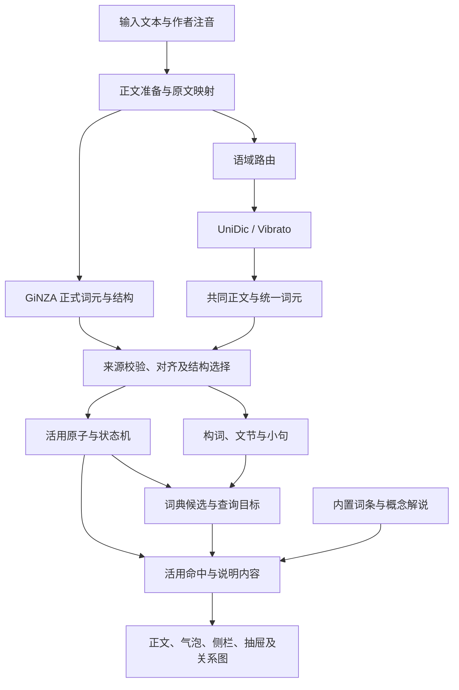

# 分析流程与模块协作

更新日期：2026-11-09。本文说明当前调用、阶段产物及坐标协作。概念入口见[总览](README.md)。

## 本机分析入口

[AnalysisService](../../crates/readux-core/src/analysis.rs) 分派请求，[AnalysisEngine](../../crates/readux-core/src/analysis_engine.rs) 持有词法 provider、外部 provider、分析对象、词典和缓存。入口决定执行的阶段。

| 入口 | 输入与实际行为 | 产物 |
| --- | --- | --- |
| `Analyze`；CLI `inspect`、`repl` | 准备正文、选择语域、UniDic 分词并统一；请求可附连续结构、grammar 或 expression 数据 | 基础 `UnifiedDocument` |
| `Enrich` | 对已有文档调用 GiNZA，使用原 UniDic 结果重新统一，保留允许继续使用的外部覆盖数据 | 更新后的文档及 provider 诊断 |
| 文档会话完整单元 | `analyze_complete` 查询缓存，未命中时顺序执行 UniDic、GiNZA、统一分析、词典目标构建 | 文档、查询目标组及阶段状态 |
| 静态书籍与指南 | 制作阶段调用本机服务；浏览器读取已生成分析和查询资源 | 发布或课节快照 |

完整单元要求 GiNZA 返回可用结果，来源失败会返回单元错误。基础 Analyze 可独立生成词法与活用结果；其结果与追加结构后的分析可能具有不同的核心归属和接续判断。

## 数据流

图示表示数据依赖。当前完整单元在 UniDic 完成后调用 GiNZA；统一函数内部的装配顺序如下。

## 统一分析的装配

[unify_with_sources](../../crates/readux-nlp/src/unify.rs) 接收准备后的正文、UniDic 来源、语域及完整来源列表，校验外部来源后进入 `assemble`。`unify_with_external` 接收连续跨度协议，先转换为完整来源形式；转换结果保留 `syntax_import` 身份和无依存诊断。

| 顺序 | 处理 | 保存内容及下游用途 |
| --- | --- | --- |
| 1 | 校验 UniDic token 与正文 | 范围、表面串、顺序；记录 token 间的 `gaps` |
| 2 | 建立 `MorphemeToken` | `m<index>`、来源索引、POS、词元、出现假名和查询形式；可能动词补充优先查询词元 |
| 3 | 校验作者 ruby | 作者读法与出现读法的对应、实际范围和原文范围 |
| 4 | 来源结构整合 | 本地句界与引号域、外部连续结构、逐 token 对齐、多对多组和来源图 |
| 5 | 结构选择 | 完整模型来源存在时，将图中选定的结构候选应用到 `structure` |
| 6 | 活用 | `collect_with_external` 生成原子链，再执行状态机、谓语关联、路径识别及 occurrence |
| 7 | 构词 | `collect_formations_with_sources` 形成候选，`attach_words` 关联核心、活用链和查询形式 |
| 8 | 文节与小句 | `collect_bunsetsu`、`collect_clauses` 映射来源范围及成员，保留状态和冲突 |
| 9 | 词典候选 | `collect_dictionary_candidates` 及 `add_morphology_candidates` 汇总词汇查询输入 |
| 10 | 基础功能候选与投影 | 生成 `grammar`，建立空 `expression`，`projection::from_layers` 保存稳定引用；`application` 使用默认值 |

统一文档协议为 `readux.unified-document.v10`。统一装配完成后，本机服务可按请求合并 grammar 或 expression 覆盖数据。`Analyze` 与 `Enrich` 的覆盖合并发生在装配之后，`projection` 不会随该合并自动重建；读取覆盖结果时应核对对应集合。

## 各层对象的职责

`SourceAnalysis.tokens` 保存 UniDic 原始字段和成本，`morphemes` 保存供其他模块引用的词法出现。GiNZA 的原始实体与关系保存在 `external_sources`，对齐结果保存在 `provider_token_alignments`，统一图保存在 `structure_graph`。各层通过当前文档内的身份和正文范围联系。

`FormationNode.word` 表示来源整体范围、词头、成员和查询形式；`dictionary_status` 等字段保留词典确认状态。GiNZA 一个正式 token 可以覆盖多个 UniDic token，跨正式 token 的 compound 依存也可形成候选。词典服务继续验证候选并确定查询范围。

`bunsetsu` 和 `clause` 记录当前来源结构的映射。它们为阅读与后续分析提供成员和边界；L7、L8 将另行确定词组、修饰及格关系的判断方法。

`grammar::collect_functional_candidates` 依据助词、助动词及非自立 POS 产生 `candidate`，`concept_id` 为空。活用的 `morphology.occurrences` 已有自身规则、范围与概念关联，两类产物分别维护。

## 查询目标与正文交互

[dictionary/targets.rs](../../crates/readux-core/src/dictionary/targets.rs) 根据统一结果和词典证据生成 `LookupTargetGroup`，保存外层、内部及候选词汇目标、语法目标、排除范围、覆盖状态和默认对象。词汇目标引用成员、活用核心、构词候选及查询形式；语法目标引用范围、链和可用的 concept。

查询构建先确定功能成分及应排除的范围，再组织词汇候选与词典确认。整体词与内部子词分别保留。作者 ruby、基本表记、词元和活用链查询形作为相应证据进入查询。具体词典聚合流程继续由[词典模块](../dictionary.md)整理。

[lookupPresentation.ts](../../src/reader/lookupPresentation.ts) 根据查询目标及活用链生成正文命中、词干说明和活用步骤。[morphologyBubble.ts](../../src/reader/morphologyBubble.ts) 生成词条内容、句中组成和规则分支；D3 布局与绘制由 `morphologyGraph.ts`、`ReaderMorphologyGraph.vue` 等组件承担。

「女の子でした」中，词汇目标支持「女の子」查询，活用命中覆盖「でした」；「諦めてくれ」中，词汇词干、て连接器和补助子链具有各自范围。界面据此显示词典、当前活用和完整句中组成。Rust 的 `projection.rs` 只生成通用层引用，活用命中主要由上述 TypeScript 投影生成。

## 文档单元与坐标

[DocumentPlan](../../crates/readux-core/src/document_plan.rs) 先准备全文并路由语域，再划分带 `anchor.char_range` 与 `context_range` 的单元。anchor 是单元负责交付的正文范围，context 提供分析上下文。`unit_input` 截取正文、作者注音及原文映射，范围转换为单元局部坐标。

完整分析接收的查询范围为 anchor 相对 context 起点的范围。前端会话记录单元上下文起点，正文命中时转换为全文坐标；内部查询及分析对象继续使用所属单元的坐标。跨单元引用需同时保留单元身份。

字符范围统一采用 Unicode scalar 的半开区间。UTF-8 字节范围、原始输入范围和 DOM 位置的转换要求见 [L2](lexical_input.md#正文坐标与来源引用)。

## 缓存及静态消费

完整单元缓存同时保存 `document` 与 `lookup`，使用内存缓存及 `analysis-cache/*.msgpack`。缓存身份涵盖协议、输入、语域、活用配置、provider 和词典等已有依赖。读取时核对文档协议、输入身份、正文及外部来源。规则嵌入 Rust 构建，修改后需要使用新构建生成新分析。

静态书籍制作入口为 [generate_static_library.py](../../scripts/generate_static_library.py)，浏览器适配为 [staticAnalysis.ts](../../src/services/staticAnalysis.ts)。发布资源包含正文、计划、分析分片和查询索引；浏览器按范围取得已生成内容。

指南制作入口为 [generate_grammar_guide_analysis.py](../../scripts/generate_grammar_guide_analysis.py)，课节分别保存内容、分析和词典快照。指南与阅读器复用正文及说明投影。调整规则后，前端配置更新与分析快照更新分别生效；相关快照需由最新分析服务重新生成。

## 过时流程及后续接入

`language_analysis::apply` 保留通用规则转应用决定、解释和阅读单位的实现，普通分析及完整单元未调用它；`refresh_language` 当前复制并记住已有文档。`PreviewRule` 仍调用 `language_analysis::preview`。`ApplicationArtifact`、`Explanation` 等类型可作为后续研究输入，现有空值和独立调用状态应如实理解。

后续词组、格关系及登记模式模块会消费基础身份、活用和 UD 证据，并生成具体用法及显示内容。执行顺序、对象和接口属于 L7–L11 的待讨论内容。本轮保留其位置及可用基础。

## 主要入口

| 范围 | 入口 |
| --- | --- |
| 统一装配 | [unify.rs](../../crates/readux-nlp/src/unify.rs)、[model.rs](../../crates/readux-nlp/src/model.rs) |
| 应用与基础投影 | [application.rs](../../crates/readux-nlp/src/application.rs)、[projection.rs](../../crates/readux-nlp/src/projection.rs) |
| 构词及词典候选 | [formation.rs](../../crates/readux-nlp/src/formation.rs)、[lexical.rs](../../crates/readux-nlp/src/lexical.rs) |
| 来源结构映射 | [bunsetsu.rs](../../crates/readux-nlp/src/bunsetsu.rs)、[clause.rs](../../crates/readux-nlp/src/clause.rs) |
| 服务与会话 | [analysis_engine.rs](../../crates/readux-core/src/analysis_engine.rs)、[document_session.rs](../../crates/readux-core/src/document_session.rs) |
