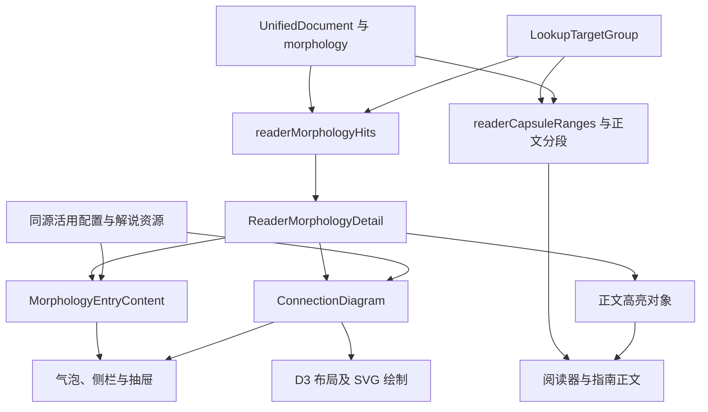

# 分析结果、解说与界面投影

更新日期：2026-11-09。本文为 L11，说明当前活用分析、词典目标到正文、解说和关系图的语义映射。输入与执行见 [L1](pipeline.md)、[L4](morphology.md)，解说资源见 [L6](entries.md)，视图和图组件分别见 [M3](../explanation_layout.md)、[M4](../analysis_graphs.md)。

## 投影的输入与输出

当前界面同时消费统一文档和词典查询目标。分析确定词元、活用操作、父子链及连接路径，词典服务确定可查询的词汇范围，前端按这些身份和范围组织内容。

Rust `projection.rs` 保存通用层引用。当前活用界面的直接入口是 [lookupPresentation.ts](../../src/reader/lookupPresentation.ts)、[morphologyBubble.ts](../../src/reader/morphologyBubble.ts) 及正文投影；具体词汇验证由 [M5](../dictionary.md) 定义。

| 对象 | 当前用途 |
| --- | --- |
| `LookupTargetGroup` | 外层、内部、候选词汇目标及语法目标，含成员、范围、查询形和决定 |
| `ReaderTargetPresentation` | 词典表头的原文词性、活用型、实际表记、查询形及副词资格 |
| `ReaderMorphologyHit` | 一个正文命中范围、所关联词汇 target ID、详情及 stem／grammar 角色 |
| `ReaderMorphologyDetail` | 当前词形、名称、推导、标签、候选状态、词条内容、接续图和高亮对象 |
| `MorphologyEntryContent` | 词条本体、身份、实际活用、用法、局部变化、摘要和例句 |
| `ConnectionDiagram` | 句中组成、前接规则分支、目标及前项节点、状态和诊断 |

## 身份与范围

词汇 target ID 标识查询对象，`chain_id` 标识活用链，`operator_id` 标识本句一步操作，occurrence 标识可解释的实际出现。图节点和高亮引用这些本句身份；配置的 operator kind、rule/path ID 与 concept 关联规则定义及解说内容。

| 范围 | 投影时的职责 |
| --- | --- |
| target `char_range` | 词典认可或回退的词汇范围 |
| chain `char_range`、父子链 | 完整活用及补助家族、胶囊扩展范围 |
| occurrence `hit_ranges` | 活用说明在正文中的入口，可有多段 |
| operator `char_range` | 操作成员范围及句中节点组成 |
| connection `predecessor_range` | 当前规则实际采用的局部前项 |
| connection `context_range` | 含连接器及登记插入项的接续上下文 |
| sentence part `range`、`unit` | 图中一段正文与所属解释对象，用于选择和高亮 |

范围均使用准备后 Unicode scalar 半开区间。单元分析中的范围为局部坐标；阅读器在显示时增加 context 起点，保存收藏时使用全文位置。图节点及局部请求继续引用所属单元，转换契约见 [L2](lexical_input.md#正文坐标与来源引用)。

## 词汇范围与正文分段

`readerCapsuleRanges` 从 outer target 读取词汇核心、构词关联及重叠核心成员，回溯根链并收集后代补助链，扩展到完整显示范围。重叠显示范围合并为胶囊，原查询目标身份继续保留。

`readerTargetPresentation` 优先从 target 的词汇核心定位 anchor，再从成员或重叠语素中选择有词性的对象，读取来源 `cType` 和查询形。词典表头的原文身份与词典记录自身的词性、读音分别呈现。

指南的 [projectReaderSentence](../../src/reader/capsuleProjection.ts) 按外层目标、内部目标、胶囊、活用命中和 ruby 边界切分正文。阅读器在 `ReaderDocumentView.vue` 中结合块及单元执行相应投影。`componentForRange` 从包含当前位置且 decision 为 `queryable` 的内部目标中选择最小范围。

作者 ruby 先使用 `ruby_validations` 的修正范围，未覆盖部分继续使用原注音；显示时按汉字与送假名分段。显示范围、ruby 范围和词典范围分别保存，通过共同正文坐标关联。

## 活用命中与词干入口

`readerMorphologyHits` 先为链找到所属词汇目标：优先匹配根链 ID，再使用构词链引用或 anchor 包含关系；内部目标可回到其外层目标。随后分两类生成命中。

occurrence 命中从 `operator_ids` 找到对应步骤，选择同 kind 或末个 operator，生成推导、词条和接续图，并对每个 `hit_range` 生成 grammar 命中。链内原子 `conjugation`、合成词干变化及同形词干另生成 stem／grammar 入口。

词干与活用尾部的拆分依赖来源 `cType/cForm` 和 `inflectionStemAndEnding`。根链的一段动词未然形、连用形可保留完整词干；其他可拆词形保留词干与首个活用尾部的共同高亮对象。纯假名、复合形式等按具体拆分函数采用实际范围。

名词、代名词和普通副词词干设置 `entryVisible: false`，句中关系存在后续组成时显示接续图；サ变词汇核心及具备活用资格的副词继续按实际状态提供入口。所有词性的句中图不足两个元素时均省略接续图；独立无活用词沿用词典查询。

## 词条与局部变化

`morphologyEntry` 从 operator 的 concept、定义、support、执行器及本句 POS 生成词条。补助形式采用展开本体，例如「ている」对应词条「いる」；缩约形式保留展开关系与本句表面串。复合条目按末成员读取实际活用。

`resolveOperatorStep` 等推导函数组织基本形到当前步骤的输入输出，词干及首个活用保留所需完整变化，后续成员提取局部变化。`morphologyLocalTransition` 从推导中选择可显示的箭头片段；缩约补助按命中路径恢复て／で等实际关系。

摘要与例句的读取顺序由 [L6](entries.md#活用内容的读取顺序) 定义：主要使用 concept 功能摘要和日中例句，结合内置助动词内容；`polite_negative` 有「ません」专门分支。当前 concept 映射以 `concept_id` 读取解说，具体用法证据继续保存在分析对象中。

## 句中组成与前接规则

`morphologySentenceParts` 从当前链回溯根链，收集完整父子家族并按正文排序。配置 operator 拥有的成员与词汇核心形成互斥分段；重叠规则优先选取完整范围。每段保存表面串、原型、功能标签、实际活用、折行关系、选择态和所属 unit。

同一 operator 可按成员生成多个节点；插入项及 `presentation.sentence_compounds` 指定的形式采用完整节点，目前包括「かもしれない」。补助层及认识单元的折行依据 `presentation.sentence_layers` 和连接器位置组织，几何实现见 [M4](../analysis_graphs.md)。

判断词尾从链内前置成分及 anchor 恢复谓语身份，关系名称采用名词谓语、形容动词及具体判断功能。名词化、条件、推量、补助和词性派生分别读取对应规则及前后状态。成员自身的活用来自来源字段和状态。

`morphologyConnectionDiagram` 按 `connection.rule` 读取配置路径，以 `matched_paths` 标出本句命中。含 connector 的路径展开其 `connector_paths` 引用，保留独立连接器；て／で形成两个分支。路径按 group 组织词类及细分类，图中当前前项来自 `predecessor_range` 末端对应的句中节点。

词干图使用同一家族的 sentence，按词干范围选择节点，branches 为空。当前语法步骤的图同时包含完整句中组成和该步骤的前接规则，candidate 状态交给规则区显示；diagnostics 保留在图数据中。

## 图节点、正文与高亮

`morphologyHighlightForToken` 根据范围相交找到 sentence part，依次优先完全相同范围、已选节点和首个相交节点，输出唯一 `unit`、完整 `range` 及颜色分段。可拆词干与首个活用共同使用一个高亮对象，内部以 blue／grammar 分段。

正文与指南同步消费该结果，`ReaderCapsule` 按字符宽度绘制单一背景及内部渐变。高亮选择在数据投影阶段完成，异步词典请求及 SVG 绘制随后更新各自内容。

图中句中节点发出 `select(id)`。宿主查出该 sentence part 的正文范围，找到相应正文成分及当前有效 target，再调用原有打开查询逻辑。阅读器通过单元 context 转换位置，指南使用例句局部范围；当前节点切换与正文选择保持同一身份。

## 代表对象

| 正文 | 查询、说明与图示的对应 |
| --- | --- |
| 女の子でした | 「女の子」为词汇查询；`copula_past` 说明完整「でした」，原型及末成员活用供表头使用 |
| 諦めてくれ | 词汇「諦める」、て连接器及补助「くれる」保留各自范围，句中图显示完整父子链及命令形 |
| はずなの | 名词「はず」、连接器「な」、名词化「の」具有独立节点；前项读取な的输入 |
| 読んでしまっていた | 根链与递归补助链共同形成句中组成，当前步骤的前接树独立更新 |
| かもしれなくなる | 「かもしれない」整体采用末尾ない的活用，后续变化补助按所属层呈现 |

已有复杂句和接续分支快照提供范围审阅材料，入口为 `data/validation/morphology_static_cases.json`、`morphology_stage11_cases.json` 及指南快照。前端投影与图布局已有对应 `.test.mjs`；规则修改后的快照制作见[开发说明](../development.md#更新指南快照)。

## 显示修订与后续接入

[显示规范与修订设计](morphology_display_conventions.md) 已规定统一术语、具体用法名称、七组前接分类及句中节点文字，并列出待实施差异。本文记录现有投影：`formLabel` 当前将意志推量形映射为未然形，补助节点常用“补助”标签，そう的关系名区分样态／传闻而词条摘要仍按共用 concept 读取。后续修改按该规范同步名称、摘要和节点。

前接树当前按 path.group 和 steps 投影；て／で选择与缩约展开会读取 steps 的末项文字，ずに另有成员过滤。统一分组和条件文案时需同时处理这些消费关系，具体清单见显示规范。

阅读器消费会话单元及查询服务，指南消费例句文档、目标组和词典快照；两者共用活用内容、范围投影和图组件，分别管理当前对象、查询异步状态及页面坐标。三种视图继续使用相同详情对象，布局选择由 M3 定义。

后续词组、格关系和登记模式需要说明整体与组分范围、具体关系、用法、解说及正文选择，并提供可定位的图节点身份。当前范围、锚点、内容分区和绘制接口可作为接入基础；新增分析对象、关系图数据及与活用的组合方式在 L7–L10 方案确定后讨论。
