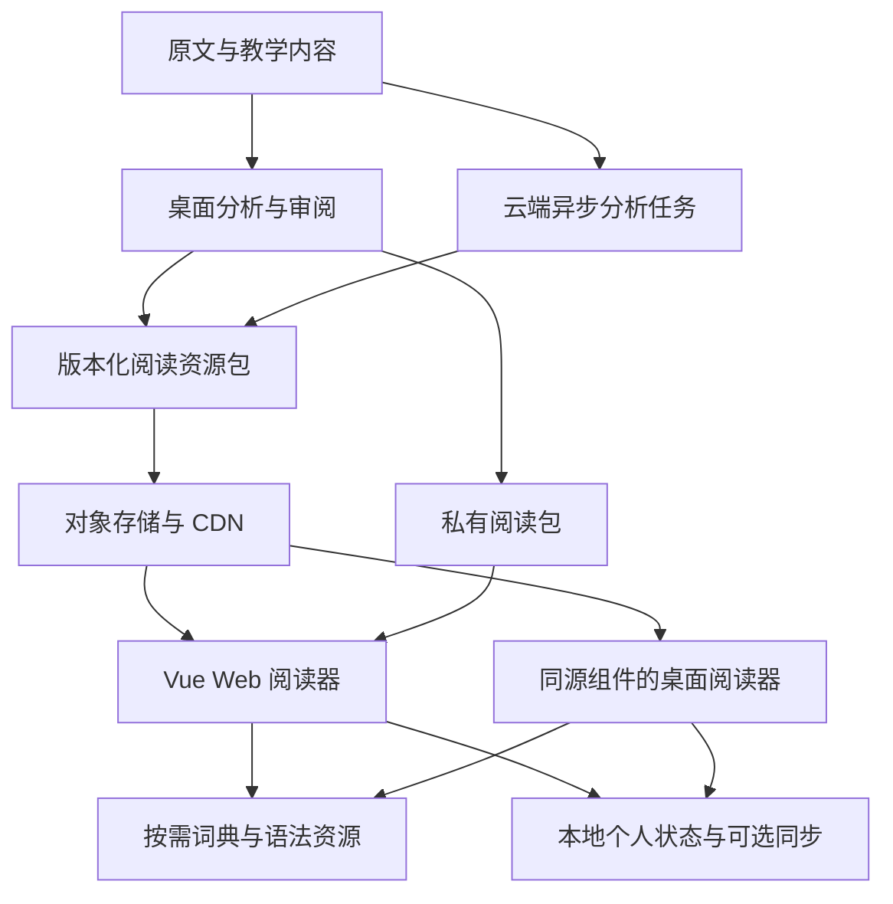

# Web 产品路线与资源架构建议

本文结合 2026-10-23 的[市场与产品策略原稿](</D:/Downloads/market_and_product_strategy.md>)及[静态空间实测](static_storage_measurement.md)，提出路线建议，供后续决策。现有云端实施计划仍见[云端 SaaS 路线](cloud_saas_roadmap.md)。

## 产品意义

推荐确定“Web 提供完整阅读入口，桌面提供本地分析与离线工作，云端按需生成新内容”的产品形态。10 万字完整阅读资源压缩后约 6–8 MiB，意味着胶囊阅读可以直接通过链接分发，并在手机、平板和桌面浏览器消费。复杂的分析环境集中在内容生成阶段，阅读阶段直接读取产物。

原策略强调独立阅读器对正文渲染的控制权。浏览器中的独立 Vue 阅读页面同样拥有正文、字符坐标、虚拟滚动和气泡定位的控制权，可以承载预分析后的完整胶囊体验。语法指南因而具有两项价值：作为可直接使用的教学内容，以及验证 Web 阅读交互和资源协议的首个正式模块。

Web 阅读可作为持续使用的主入口，桌面端提供私有书籍本地处理、批量分析、离线词典和本机工具联动。已有 Rust、UniDic、GiNZA 和词典处理工作继续作为内容生成能力复用。

产品路径可从“一课指南中的交互例句”延伸到“一章真实读物”，再到“读者自己的书”。课程用户与原版阅读用户具有不同的初始需求，适合以具体知识点和短篇阅读建立连接，分别观察持续阅读和导入新内容的需求。

## 内容与服务的扩展方向

预生成资源支持稳定引用具体句子和成分。为课节、概念、文档版本及字符范围建立链接后，可以实现“语法指南解释—真实语境实例—阅读摘录—复习卡片”的连续操作。概念到实例的索引可随内容生成，个人掌握情况独立保存。

教学价值可以通过人工审阅积累：同一分析结果支持局部修正、例句替换和难度标注，随后发布新内容版本。模型和规则继续改进，已审阅内容拥有明确的发布版本；用户笔记以文本版本和字符锚点定位。

内容包具有独立的分发价值。读者可下载一章或一本书的阅读资源；教师可制作带重点范围和概念引用的读物；桌面分析完成后可导出私有阅读包，在浏览器中导入并继续阅读。跨设备同步可按实际需求接入。

生态桥接保留原策略中的输入和输出方向。早期适合提供兼容常用字段的制卡导出，桌面接入 AnkiConnect；网页直连本机服务需要单独验收浏览器访问条件。浏览器扩展可承担正文提取和发送，完整阅读体验由统一页面承载。

商业设计可围绕新增处理和持续服务展开：公开课程和示例降低首次体验成本，私人书籍分析、跨设备同步、批量处理和经审阅的教学内容提供付费价值。新文本分析量、已有内容阅读流量、词典查询和个人状态同步分别计量，便于明确成本及定价依据。

## 推荐架构

生成服务输出统一的发布资源：manifest、正文与章节、注音、分片胶囊及内外层目标、查询参数、局部活用提示、词典及语法引用。完整来源、对齐图和诊断保存在生成侧，供审阅和重新生成。展示资源保留运行所需信息，资源依赖声明 schema、正文、分析及词典版本。

初期直接部署 Brotli 压缩 JSON。阅读资源可按约 4,000–8,000 字组织分片，加载当前范围并预取相邻范围；词典按词形索引和正文块加载，语法通过概念 ID 查询。常用语法和少量词典索引可以提前加载，首次远程查词单独呈现加载状态。资源地址带版本，长期复用不可变资源。

现有阅读服务入口 src/services/reader.ts 在浏览器中直接拒绝桌面请求。正式书籍 Web 化需要抽取宿主数据适配：打开文档、读取范围、查词、解析引用及保存个人状态；本地版本调用 Tauri，Web 版本读取静态资源或访问对应服务。Vue 组件继续消费统一的阅读对象和用户意图。

静态包读取与新文本分析具有不同的生命周期：已有内容按范围立即读取，新内容显示真实的生成进度，已完成范围可以先进入阅读。生成任务使用可恢复的异步接口，CPU 负责导入和词典索引，GPU 负责需要模型推理的阶段。缓存身份应包含文本、分析上下文及所依赖的资源版本。

个人进度、笔记和词汇状态独立保存。首版 Web 可使用 IndexedDB 保存阅读状态及下载分片，后续账户服务同步小规模增量。服务端数据库负责用户、任务、权限和状态；大体积正文与阅读资源由对象存储提供。SQLite/WASM 的引入由浏览器端全文检索和离线词典需求决定。

虚拟滚动控制 DOM 数量，资源窗口及缓存预算控制 JavaScript 对象和内存占用。每千字展示 JSON 原始约 819 KiB，解压及解析后的内存需要实测；浏览器按当前章节或邻近单元装载，尤其需要验证手机和平板。移动端另行设计点击、长按、选择和气泡定位，沿用胶囊的数据语义。

公开内容与个人内容采用独立分发范围：公开书库使用自有或获授权内容，个人书籍保存为私有包；词典按照可提供的授权范围配置资源。内容生成完成并不改变原文和词典的分发条件。

## 推荐顺序与验收

| 阶段 | 交付 | 用于决定下一步的证据 |
| --- | --- | --- |
| 1. 语法指南正式 Web 版 | 两课按需加载、完整胶囊及气泡、稳定课节链接、桌面浏览器和触摸操作 | 读者能发现词义与词尾两类交互，实际查词完成率、首次可交互时间及继续阅读情况 |
| 2. 预分析读物与私有包导入 | 真实章节、书架、虚拟滚动、阅读进度、离线缓存、制卡导出 | 持续阅读时长、次周返回、章节继续阅读率，以及用户导入自己书籍的需求 |
| 3. 私人书籍云端分析 | 上传、异步生成、范围交付、私有缓存、账户与额度 | 新增分析成本、生成等待、缓存复用率、失败恢复和付费使用 |
| 4. 生态与内容扩展 | 桌面桥接、正文投送、课程实例索引和教学内容制作 | 高频工作流和实际留存收益，决定扩展的优先级 |

Web 阶段可以与 GPU 实验并行推进。公开的已分析内容直接通过静态资源发布，个人新书处理接入现有云端核心；账户、订阅和计算调度在对应需求出现时形成完整服务。

首批验证宜选择少量真正阅读原版的学习者，通过相同段落对照原有工作流，观察查词次数、范围修正、理解结果和阅读中断。原策略中的社区规模、准确率及竞品体积来自其原有调研口径；当前选路的直接证据是资源实测和正式代码。对外质量数字应附任务定义及标注样本，产品页面可优先展示可复现的连续活用和整体／组分查询实例。

## 当前可执行的下一步

先形成语法指南的独立浏览器入口和静态资源发布器，将现有两课作为正式可用内容；同时定义与书籍共用的 manifest、查询引用和阅读状态协议。随后接入一篇真实读物，验证从课程到自主阅读的使用路径。产品入口、资源协议和用户反馈可以先成熟，云端分析接入沿用同一阅读产物。
